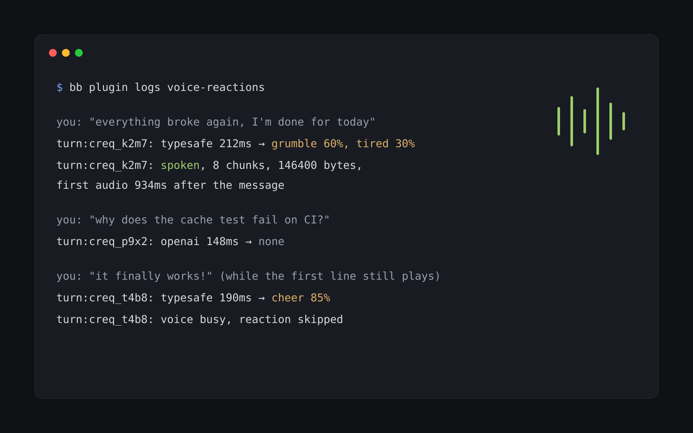

# bb-plugin-voice-reactions

BB plugin: a short spoken reaction to what you write to your agents.



[](https://github.com/neoromantic/bb-plugin-voice-reactions/actions/workflows/ci.yml)
[](https://github.com/neoromantic/bb-plugin-voice-reactions/releases)
[](LICENSE)

An unofficial plugin for [BB](https://github.com/get-bb/bb). When you send a message to an
agent, a fast decision model picks a reaction for it, or none, and a voice model says one short
line in the character you choose: a grunt of sympathy when everything broke, "very good" when
you hand the work over, silence for an ordinary question. It runs on the BB server, never
delays your message and uses experimental BB plugin events, so a BB update can break it.

The sound plays **on the machine that runs the BB server**, not in the browser. It fits BB on
your own computer; with a remote BB server you will not hear it.

## Install

Needs BB 0.49.0 or later, an audio player on the server machine and at least one API key.

```sh
bb plugin install git:https://github.com/neoromantic/bb-plugin-voice-reactions.git@semver:^0.2.0 --yes
```

The player is found automatically: `ffplay` (part of [FFmpeg](https://ffmpeg.org), any
platform), SoX `play`, or `aplay` / `paplay` on Linux.

```sh
brew install ffmpeg        # macOS
sudo apt install ffmpeg    # Debian, Ubuntu
winget install ffmpeg      # Windows
```

## Quickstart

1. Give the plugin a key that can decide and one that can speak. A TypeSafe key decides and an
   OpenAI key speaks:

   ```sh
   bb plugin config voice-reactions set typesafeApiKey <key>
   bb plugin config voice-reactions set openaiApiKey <key>
   bb plugin reload voice-reactions
   ```

   One OpenAI key can do both only if its project has access to the Decisions model
   `gpt-6-luna` as well as to the Realtime model; without it the log shows
   `decision failed: HTTP 403`. A key already in the BB server's environment
   (`TYPESAFE_API_KEY`, `OPENAI_API_KEY`, `AI_GATEWAY_API_KEY`, `OPENROUTER_API_KEY`) is picked
   up without this step.

2. Tell any agent "great, go ahead" and listen.
3. See what happened:

   ```sh
   bb plugin logs voice-reactions
   ```

   ```text
   turn:creq_k2m7: typesafe 212ms → ack 85%
   turn:creq_k2m7: spoken, 6 chunks, 96000 bytes, first audio 910ms after the message
   ```

`bb plugin disable voice-reactions` turns it off at once and stops a line that is playing.

## Features

- Reacts to what a person types: a root thread's first prompt, follow-ups, steers and
  follow-ups queued while the agent works. Messages from agents, plugins, BB itself and retries
  are ignored, and each message is handled once.
- The reaction is a decision, not a keyword match: one multiple-choice question whose options
  you write. Close runners-up are mixed in, so a message can be 60% `grumble` and 30% `tired`.
- By default an ordinary question or instruction gets `none`. Handoffs, thanks, good news,
  irritation, fatigue, surprise and an explicit request to speak get a reaction.
- Sixteen roles to speak in, from a deadpan butler to a starship computer, a Thai-English
  shopkeeper or a doting grandmother, a random one per line, or a character you write yourself.
- The voice model writes and speaks the line itself. No text step in between, no audio files:
  chunks go straight to the player.
- One line at a time and no backlog: a reaction that arrives while a line is playing is skipped.
- Decides with TypeSafe, the OpenAI Decisions API, Vercel AI Gateway or OpenRouter. Speaks with
  OpenAI Realtime, over a socket kept warm, or with OpenRouter.
- A failure only writes a log line. Logs hold no message text and no keys.

## Usage

Settings are in **Settings → Plugins → Voice reactions**, or
`bb plugin config voice-reactions set <setting> <value>`. They apply to the next message.

| Setting            | Default  | What it does                                                                              |
| ------------------ | -------- | ----------------------------------------------------------------------------------------- |
| `reactions`        | built in | The question and its options; see below                                                   |
| `role`             | `butler` | Who reacts: one of sixteen characters, `random`, or `custom`                              |
| `persona`          | –        | Your own character text, used when `role` is `custom`                                     |
| `language`         | auto     | Language of the line. Empty: Russian or English after the message, else the message's own |
| `voice`            | role     | Voice name. Empty: the role's own voice on OpenAI, `alloy` on OpenRouter                  |
| `player`           | auto     | A player's path, or a full command that plays 24 kHz 16-bit mono PCM stdin                |
| `decisionProvider` | `auto`   | `typesafe`, `openai`, `gateway` or `openrouter`; auto takes the first key                 |
| `decisionModel`    | provider | Model id for the decision                                                                 |
| `voiceProvider`    | `auto`   | `openai` or `openrouter`; auto prefers OpenAI                                             |
| `voiceModel`       | provider | Model id for the voice: `gpt-realtime` or `openai/gpt-audio`                              |
| `typesafeApiKey`   | –        | Decides. Stored as a BB secret setting, like the three below                              |
| `openaiApiKey`     | –        | Decides and speaks                                                                        |
| `aiGatewayApiKey`  | –        | Decides. A Vercel AI Gateway key cannot speak                                             |
| `openrouterApiKey` | –        | Decides and speaks                                                                        |

### Reactions

Each line shaped `name: when it fits: how to react` is an option; names are lowercase Latin. Any
other line is the question. `none` means stay silent. To react only when asked:

```sh
bb plugin config voice-reactions set reactions "$(cat <<'TEXT'
Does this message ask for a spoken reaction?
none: anything else
spoken: they explicitly ask for a voice reaction: an eager, playful reply
TEXT
)"
```

The built-in list has 16 reactions and `none`; it is `DEFAULT_REACTIONS` in
[`src/prompts.ts`](src/prompts.ts). An empty setting brings it back.

### Roles

Sixteen characters are built in, plus `random`, which draws a different one for every line:

```sh
bb plugin config voice-reactions set role starship
```

`butler` (the default), `starship`, `sitcom`, `gloom`, `foreman`, `shopkeeper`, `pirate`,
`coach`, `monk`, `narrator`, `sysadmin`, `grandma`, `noir`, `cowboy`, `chef`, `surfer`. Each
has its own accent, manner and voice: a posh English butler, a Scottish sysadmin, a French chef
who gasps "sacrebleu". The reaction says what to feel, the role
says who feels it: the same irritation is "Most unfortunate, sir" from the butler and "Morale
at forty percent, Captain" from the starship. For your own character set `role` to `custom`
and write it in `persona`; the text stays saved while you try other roles. See
[docs/roles.md](docs/roles.md).

### Providers

|                   | Decides                       | Speaks                             |
| ----------------- | ----------------------------- | ---------------------------------- |
| TypeSafe          | `jev-latest`                  | –                                  |
| OpenAI            | `gpt-6-luna` (Decisions API)  | `gpt-realtime` (Realtime, fastest) |
| Vercel AI Gateway | `typesafe-ai/jev`             | –                                  |
| OpenRouter        | `openai/gpt-6-luna-decisions` | `openai/gpt-audio` (streamed chat) |

Checked against the live services: TypeSafe, Vercel AI Gateway and OpenAI Realtime. The OpenAI
Decisions API, OpenRouter's alpha decisions endpoint and its voice path follow their
documentation and have not been run live; the OpenRouter voice also starts slower than the
Realtime socket. OpenAI shuts `gpt-realtime` down on 2027-01-20; set `voiceModel` to its successor then.

## Privacy

Every message you type, cut to 800 characters, goes to the decision provider together with up
to 300 characters of what it replies to. When a reaction is spoken, the same text goes to the
voice provider. Nothing is stored by the plugin. Details, the message filter and the known gaps
are in [docs/how-it-works.md](docs/how-it-works.md).

## For AI agents

The plugin has no commands and no skill. It ignores everything an agent sends, including
`bb thread tell` from inside a thread and the first prompt of a thread an agent spawns.

## Contributing

See [CONTRIBUTING.md](CONTRIBUTING.md).

## Security

See [SECURITY.md](SECURITY.md).

## License

[MIT](LICENSE)
